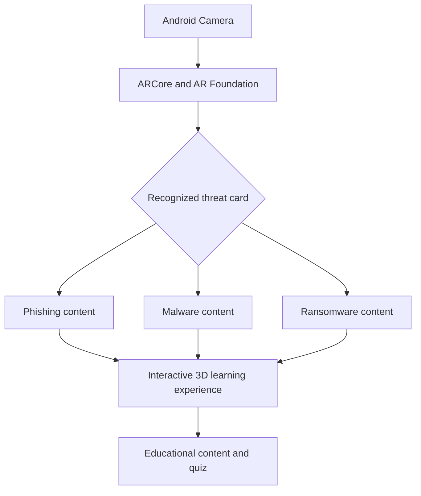

<div align="center">

# 🛡️ CYBER THREAT AR

### Making Cybersecurity Threats Visible Through Augmented Reality

**An Interactive Cybersecurity Education Experience · Unity · Android**


**Scan a card · Explore a cyber threat · Learn how to stay safe**

</div>

---

## Overview

**CYBER THREAT AR** is an educational augmented reality application designed to make common cybersecurity threats easier to understand. With an Android device, users scan illustrated cards representing **phishing, malware, and ransomware**. Each recognized card serves as an anchor for a threat-specific 3D experience.

The project combines **image tracking**, **3D visualization**, and planned **interactive learning features** to connect everyday cybersecurity risks with memorable visual examples.

> **Current status:** The Android AR foundation and three threat-specific animated 3D prefabs are implemented. Editor Play Mode validation and an Android ARM64 development build pass; final on-device ARCore validation of the refined models is still required. Touch interactions, educational pop-ups, and quizzes remain separate workstreams.

## Explore Three Cyber Threats

<table>
<tr>
<td width="50%" align="center" valign="top">

### 🎣 Phishing


Deceptive emails and messages that try to trick people into sharing sensitive information. **Implemented 3D visual:** an animated envelope with a continuous fishing hook and line.

</td>
<td width="50%" align="center" valign="top">

### 🐛 Malware


Malicious software that can disrupt, damage, or compromise devices and data. **Implemented 3D visual:** a recognizable bug orbiting a desktop computer.

</td>
</tr>
<tr>
<td width="50%" align="center" valign="top">

### 🔐 Ransomware


Malware that locks or encrypts files and demands payment. **Implemented 3D visual:** a safe with a detailed animated padlock.

</td>
<td width="50%" align="center" valign="top">

### 📱 Learning Experience

**1. Scan** a threat card  
**2. Discover** its 3D illustration  
**3. Explore** the explanation  
**4. Interact** with the object  
**5. Check** understanding through a quiz

*Steps 3–5 describe the intended final experience.*

</td>
</tr>
</table>

## Key Features

<table>
<tr>
<td width="50%" valign="top">

### AR & Interaction

- **Three-card image tracking** — identify phishing, malware, and ransomware cards. ✅ Foundation tested
- **Context-aware 3D objects** — display a different refined model for each card. ✅ Implemented
- **Threat animations** — float, orbit, and lock motion with balanced two-second cycles. ✅ Implemented
- **Tap & highlight** — interact with selected 3D objects. 🔧 Planned
- **Pinch & rotate** — scale and rotate models through touch gestures. 🔧 Planned

</td>
<td width="50%" valign="top">

### Education & Assessment

- **Threat information** — definitions, real-world examples, and prevention tips. 🔧 Planned
- **Contextual quizzes** — questions matched to the scanned threat. 🔧 Planned
- **Answer feedback** — color-coded responses and explanations. 🔧 Planned
- **Reset & rescan** — reset the experience for another card. 🔧 Planned

</td>
</tr>
</table>

## How It Works



*Image recognition, three refined prefab mappings, and their animations are implemented. Interactive learning layers are separate planned work.*

## Technology

| Category | Technology |
|---|---|
| Development engine | Unity 2022.3.62f3 LTS |
| Render pipeline | Universal Render Pipeline (URP) |
| AR framework | AR Foundation 5.2.2 |
| Android AR provider | Google ARCore XR Plugin 5.2.2 |
| Programming language | C# |
| Image recognition | AR Tracked Image Manager + XR Reference Image Library |
| Android configuration | OpenGLES3 · IL2CPP · ARM64 · minimum API 24 |

## Project Structure

```text
Assets/
├── 01_Scenes/         # Unity scenes
├── 02_Scripts/        # C# logic
├── 03_Prefabs/        # Reusable objects and AR content
├── 04_Models/         # 3D assets
├── 05_Animations/     # Animation assets
├── 06_Materials/      # Materials and shaders
├── 07_Textures/       # Texture assets
├── 08_ImageTargets/   # Threat cards and image library
├── 09_UI/             # User interface assets
├── 10_Data/           # Educational and quiz data
└── Settings/          # URP configuration
Packages/
ProjectSettings/
```

## Foundation Validation

<table>
<tr>
<td width="50%" valign="top">

### ✅ Configuration Verified

- Android build and ARCore setup
- XR Origin, AR Session, and AR Camera
- URP AR background rendering
- Three-card reference image library
- Image-to-prefab mapping script
- XR Project Validation: **0 issues**

</td>
<td width="50%" valign="top">

### ✅ Device Tests Passed

- **Phishing** → blue cube
- **Malware** → red cube
- **Ransomware** → gold cube
- Objects follow tracked cards
- Objects hide when tracking is lost and reappear after tracking resumes

*Tests used the cards displayed on a monitor; printed-card performance has not yet been independently verified.*

</td>
</tr>
</table>

## 3D Visualization & Animation Validation

- `Threat_Phising.prefab`: continuous J-shaped hook mesh, fishing line, envelope materials, and looping float animation.
- `Threat_Malware.prefab`: monitor stand/base, detailed bug silhouette, and looping orbit animation.
- `Threat_Ransomware.prefab`: safe-door bolts, readable keyhole, metallic lock materials, and looping lock animation.
- All three prefab roots spawn at X +90 degrees and unit scale so their local `-Z` front aligns with the tracked-image `+Y` surface normal; Phishing uses `(X 0.0025, Z -0.0355)` to overlay its 3D envelope on the printed envelope, Malware uses local position zero, and Ransomware uses Z `-0.035` to center its visual bounds on the marker.
- Unity Console: no project compilation or runtime errors during final Play Mode checks.
- Android development build: **Success** (IL2CPP, ARM64), generated as `CyberThreatAR-Development.apk` on 2026-11-08.
- APK SHA-256: `22576CD31E07018D482E5D787BDDE8810D836564EDA50A2F12AF561E788C8F71`.

The APK build validates the Android build pipeline, not live tracking behavior. A physical ARCore-capable Android device must still verify camera permission, recognition of all three cards, tracking stability, visibility changes, scale, material appearance, and animation performance.

## Development Status

- [x] Establish Unity and Android AR environment
- [x] Import three image targets and configure reference library
- [x] Implement and validate placeholder tracking on Android
- [x] Complete foundation configuration audit
- [x] Replace placeholders with animated threat-specific 3D scenes
- [ ] Implement touch interaction and object manipulation
- [ ] Add educational information panels
- [ ] Implement contextual quizzes, feedback, and reset
- [ ] Complete integrated testing and final demonstration

## Academic Purpose & Asset Credits

This project was created as an academic **Augmented Reality / Virtual Reality** assignment to explore interactive cybersecurity education.

Third-party graphics, 3D models, textures, and animations remain subject to their respective licenses. Credits will be provided for externally sourced assets where required.

---

<div align="center">
  <sub>CYBER THREAT AR · Learn to recognize digital threats before they become real problems.</sub>
</div>
