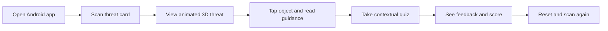

<div align="center">

# 🛡️ CYBER THREAT AR

### Explore Cyber Threats. Learn to Stay Secure.

**An interactive augmented reality learning experience for cybersecurity awareness.**


**Group 9 · AR/VR Course Project**

</div>

---

## 📖 Overview

**CYBER THREAT AR** is a mobile educational application concept that uses **Augmented Reality (AR)** to help learners recognize common cybersecurity threats. By pointing an Android device at printed **image cards**, users will be able to explore animated 3D representations of **phishing**, **malware**, and **ransomware**, read practical safety guidance, and test their knowledge through interactive quizzes.

> **Development status:** This repository is in its initial development phase. Features described below are **planned according to the Group 9 storyboard**, not yet confirmed as implemented.

## 🎯 Project Objectives

| Understand cyber threats | Learn through interaction |
| :--- | :--- |
| Explain what phishing, malware, and ransomware are, with real-world examples and prevention tips. | Turn printed learning cards into interactive 3D scenes with animations, touch controls, and educational pop-ups. |
| **Practice safer decisions** | **Apply AR technology** |
| Reinforce knowledge with contextual multiple-choice quizzes and answer feedback. | Implement marker-based image tracking on supported Android devices using Unity and AR Foundation. |

## 🃏 Threat Cards & 3D Concepts

| 🎣 Phishing | 🐛 Malware | 🔐 Ransomware |
| :---: | :---: | :---: |
| Fishing hook and letter | Computer and bug | Safe and padlock |
| A hook moves up and down | A bug circles the computer | The padlock locks automatically |
| Recognize deceptive messages and links | Understand malicious software | Learn how file-locking attacks affect victims |

## ✨ Planned Features

- **Image tracking:** Recognize three threat cards and place their matching 3D content above each card.
- **Animated 3D scenes:** Present each threat through simple visual storytelling.
- **Tap interaction:** Highlight a selected 3D object and open its educational information panel.
- **Educational pop-ups:** Explain the threat, real-world examples, and prevention methods.
- **Touch gestures:** Rotate objects up to 360° and scale them using multitouch input.
- **Contextual quizzes:** Present multiple-choice questions based on the currently scanned card.
- **Answer feedback:** Display green for correct and red for incorrect answers, with explanations and a score.
- **Reset / scan again:** Restore the initial state and allow users to explore another card.

## 🔄 Intended User Journey



## 🧰 Planned Tech Stack

| Component | Technology | Purpose |
| :--- | :--- | :--- |
| Game engine | Unity **2022.3.62f3** | Application development |
| Programming | **C#** | Interactions and application logic |
| AR framework | **AR Foundation 5.1** | Image tracking and AR integration |
| Android AR provider | **ARCore XR Plugin 5.1** | AR capabilities on supported Android devices |
| Rendering | **Universal Render Pipeline (URP)** | Mobile-oriented 3D rendering |

## 📁 Planned Project Structure

```text
Cyber-Threat-AR/
├── Assets/
│   ├── 01_Scenes/
│   ├── 02_Scripts/
│   ├── 03_Prefabs/
│   ├── 04_Models/
│   ├── 05_Animations/
│   ├── 06_Materials/
│   ├── 07_Textures/
│   ├── 08_ImageTargets/
│   ├── 09_UI/
│   └── 10_Data/
├── Packages/
├── ProjectSettings/
├── .gitattributes
├── .gitignore
└── README.md
```

The folder structure above is a **target organization**. Generated Unity folders such as `Library/` and `Temp/` should not be committed.

## 👥 Development Team

**Group 9 — AR/VR Course Project**

| Member | Student ID |
| :--- | :--- |
| Dimas Reginald Bhamakerti | F551 24 055 |
| Randy Raditya | F551 24 072 |
| Triyanti Aulia | F551 24 073 |
| Moh. Nabil Syaputra | F551 24 079 |

## 📝 Roadmap

- [ ] Set up the Unity URP project and AR Foundation / ARCore packages.
- [ ] Prepare the three image-tracking cards.
- [ ] Build animated phishing, malware, and ransomware prefabs.
- [ ] Implement tapping, highlighting, scaling, and rotation.
- [ ] Create educational panels and contextual quizzes.
- [ ] Test tracking, interaction, and usability on Android.
- [ ] Add installation instructions, screenshots, and a demo video.

## 📄 Assets & Usage

Third-party models, textures, and audio (if used) will be credited according to their individual licenses. **No open-source license has been selected for this repository yet.** Please contact the team before reusing project code or assets.

---

<div align="center">

**CYBER THREAT AR · Learn to recognize threats before they become incidents.**

</div>
