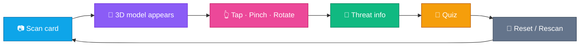

<div align="center">

# 🛡️ CYBER THREAT AR

### *Learn about cybersecurity threats with Augmented Reality*


**📷 Scan a card · 🧊 Explore the threat · 🧠 Learn to stay safe**

</div>

---

## 📖 About

**CYBER THREAT AR** is an Android AR app that teaches three common cyber threats: **phishing, malware, and ransomware**. Point the camera at a threat card and an animated 3D model of that threat appears on it. From there you can read about the threat and take a short quiz.

> [!NOTE]
> This is an academic project for the **Augmented Reality** course.

## 🎮 How It Works



| Step | What you do |
|:---:|---|
| 📷 | **Scan** a threat card with your phone camera |
| 🧊 | **See** the animated 3D model on the card |
| 👆 | **Interact**: tap to select, pinch to resize, twist with two fingers to rotate |
| 📘 | **Learn**: the definition, a real-world example, and prevention tips |
| 📝 | **Uji Pemahaman**: a 3-question quiz about that threat |
| 🔄 | **Reset / Pindai Ulang** to start over or scan another card |

## 🃏 Threat Cards

| 🎣 Phishing | 🐛 Malware | 🔐 Ransomware |
|:---:|:---:|:---:|
|  |  |  |
| Fake messages that trick people into giving away personal data. | Malicious software that damages devices or steals data. | Malware that locks your files and demands payment. |
| ✉️ Envelope with a fishing hook | 🖥️ Bug orbiting a computer | 🔒 Safe with a moving padlock |

## ✨ Features

| | Feature | Description |
|:---:|---|---|
| 🎯 | **Image tracking** | Recognizes three cards; each shows its own animated 3D model |
| 👆 | **Touch interaction** | Tap highlight, pinch scaling (0.6x–1.8x), two-finger rotation |
| 📘 | **Education panel** | Definition, example, and prevention tips for each threat |
| 📝 | **Contextual quiz** | Three A–D questions per threat, 🟢/🔴 feedback, explanations, final score |
| 🔄 | **Reset / rescan** | Returns the app to its starting state |

## 🛠️ Tech Stack

| | |
|---|---|
| 🎮 **Engine** | Unity 2022.3.62f3 LTS (URP) |
| 🥽 **AR** | AR Foundation 5.2.2 + Google ARCore 5.2.2 |
| 💻 **Language** | C# |
| 📱 **Target** | Android 7.0+ (API 24), ARM64, IL2CPP |

## 🚀 Getting Started

**📲 Run the APK:** install `CyberThreatAR_Development.apk` on an ARCore-supported Android phone, then scan the cards in `Assets/08_ImageTargets/` (printed or shown on a screen).

**🧩 Open in Unity:**

1. Clone this repo and open it with Unity **2022.3.62f3**.
2. Open the scene `Assets/01_Scenes/CyberThreatAR_Main.unity`.
3. Switch the platform to Android (**File → Build Settings**), then **Build** or **Build And Run**.

## 📂 Project Structure

```text
Assets/
├── 01_Scenes/        # Main scene
├── 02_Scripts/       # C# scripts (tracking, interaction, education, quiz)
├── 03_Prefabs/       # 3D threat prefabs
├── 04_Models/ 05_Animations/ 06_Materials/ 07_Textures/
└── 08_ImageTargets/  # Threat cards + reference image library
```

| Script | Purpose |
|---|---|
| `ThreatImageTracker` | Detects cards and spawns the matching 3D model |
| `ThreatInteractionManager`, `ThreatInteractable`, `ThreatInteractionEvents` | Tap, pinch, rotate, and reset |
| `ThreatEducationPanelController`, `ThreatEducationContent`, `ThreatEducationEvents` | Threat info panel and its content |
| `ThreatQuizController`, `ThreatQuizContent`, `ThreatQuizEvents` | Quiz flow, questions, and scoring |

## 👥 Team

<table>
<tr>
<td width="25%" align="center" valign="top">


**🧊 AR Foundation, 3D & UI**

</td>
<td width="25%" align="center" valign="top">


**👆 Object Interaction**

</td>
<td width="25%" align="center" valign="top">


**📘 Education & Reset**

</td>
<td width="25%" align="center" valign="top">


**📝 Contextual Quiz**

</td>
</tr>
</table>

| Member | Work | Scripts | PRs |
|---|---|---|:---:|
| 🟣 **Dimas** | Unity project setup with URP, ARCore and AR Foundation configuration, threat card image library and tracking. 3D models and animations for all three threats (phishing hook and envelope, malware bug and computer, ransomware safe and padlock), shared materials, motion timing, and placing each model correctly on its card. Final redesign of the education and quiz UI | `ThreatImageTracker`, `FishingHookMeshTool`, `EnvelopeFlapMeshTool` | #1 – #4 |
| 🔴 **Randy** | Tapping and highlighting threat objects, auto colliders, pinch scaling, two-finger rotation, resetting object position and size, and the tap event that opens the education panel | `ThreatInteractionManager`, `ThreatInteractable`, `ThreatInteractionEvents` | #5 |
| 🟢 **Triyanti** | Education content for each threat (definition, example, prevention tips), responsive info panel, **Uji Pemahaman** button, and **Reset / Pindai Ulang** flow | `ThreatEducationPanelController`, `ThreatEducationContent`, `ThreatEducationEvents` | #6 |
| 🟠 **Nabil** | Three A–D questions per threat, green/red answer feedback, explanations, scoring, result screen, retry and return buttons, quiz reset, and a fix so touch gestures respond directly | `ThreatQuizController`, `ThreatQuizContent`, `ThreatQuizEvents` | #7 – #8 |

---

<div align="center">

<sub>🛡️ CYBER THREAT AR · Learn to recognize digital threats before they become real problems.</sub><br>
<sub>Third-party assets remain under their respective licenses.</sub>

</div>
